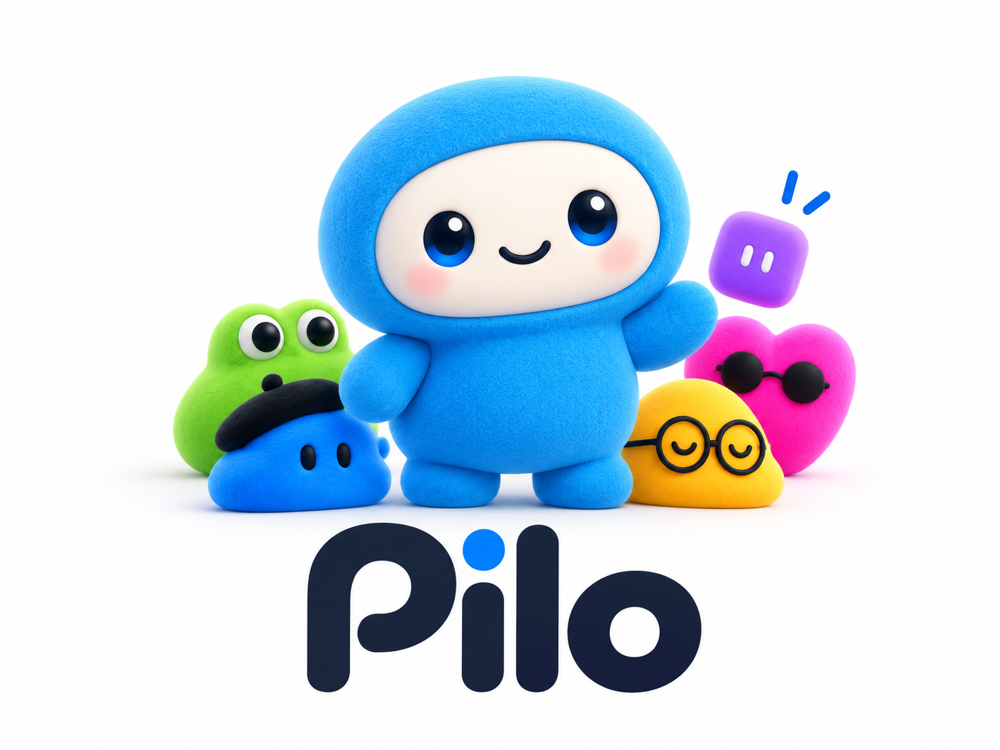

# Pilo



**Your Personal Bot inspired by Grok Bots — Source-Available**

Pilo helps you delegate research, writing, coding, marketing, job-search preparation, and permitted browser actions to personal and specialist bots. It currently runs on your computer. Hosted model requests can still incur charges; reducing unnecessary token usage is a design goal, not a verified savings guarantee.

## Before you start

- Install Git and Node.js 18 or newer, with npm.
- You need access to [iamcharlesb/browser-agent](https://github.com/iamcharlesb/browser-agent), the separate **private** repository containing the application. This public repository alone is not a complete app download.
- Have your chosen model provider credentials and model ID ready, or configure a local model. Google sign-in and MongoDB are optional.

## Install and launch

Clone with submodules so the application code is included:

```bash
git clone --recurse-submodules https://github.com/iamcharlesb/pilo.git
cd pilo
npm ci
npm --prefix node/browser_agent ci
cd node/browser_agent
npx playwright install chromium
cd ../..
npm run desktop
```

The last command builds and opens Pilo in a desktop window. Keep the terminal running while you use it. The desktop server uses port 8766 by default.

If cloning reports **Repository not found** for `browser-agent`, sign in to GitHub with an account that has access to that repository. Downloading this repository as a ZIP does not include the submodule.

## Connect a model

1. Open **Settings** in Pilo.
2. Configure your provider connection, credentials, and model selection.
3. Select the configured model in the chat composer, then send a short message to check the connection.

Keep credentials local. You can also configure `node/browser_agent/.env` using its [environment reference](node/browser_agent/.env.example). Model versions, pricing, and operational limits are configuration settings. Local Engine is a limited fallback; a capable configured model is needed for general AI tasks.

## Start your first task

1. Use **Primary Bot**, choose a specialist, or create a custom bot.
2. Start with a concrete task, such as “Draft a LinkedIn article about my project” or “Research these competitors and summarize the differences.”
3. Attach your project folder when asking for code changes.
4. For work in your signed-in browser, open **Connect Apps → Connect my Chrome** and follow the connection instructions.
5. Review requested approvals before allowing actions. Use **Stop** to cancel a run.

Start with a draft or research task so you can inspect the result before asking Pilo to take outward actions.

## Update an existing installation

From the Pilo repository folder:

```bash
git pull
git submodule sync --recursive
git submodule update --init --recursive
npm ci
npm --prefix node/browser_agent ci
npm run desktop
```

Commit or save your local edits before updating. If a Pilo server is already running on port 8766, use `npm run desktop:attach` to open a window connected to it.

## Troubleshooting

| Problem | What to check |
| --- | --- |
| Application folder is empty | Run `git submodule update --init --recursive`; confirm access to the private app repository. |
| Electron or TypeScript is missing | Run `npm --prefix node/browser_agent ci`. |
| Browser executable is missing | Run `npx playwright install chromium` from `node/browser_agent`. |
| Model does not respond | Check the selected provider, model ID, credentials, provider balance, and limits in Settings. |
| Google or Reddit blocks an automated browser | Use **Connect Apps → Connect my Chrome** with your own browser session. |
| Port 8766 is already in use | Reuse your running Pilo server with `npm run desktop:attach`. |

## More help and contributing

- [Application documentation](node/browser_agent/README.md): provider configuration, browser connection, approvals, and advanced setup.
- [CLI setup](node/browser_agent/docs/cli.md): terminal use without the desktop window.
- [Operating boundaries](node/browser_agent/docs/buddy-bot-production.md): current limitations and deployment details.
- [The story behind Pilo](https://medium.com/@iamcharlesb/meet-pilo-inspired-by-grok-bots-and-chatgpt-dots-13a17c6c5e41).
- [Report an issue](https://github.com/iamcharlesb/pilo/issues): include reproduction steps and remove credentials from logs.

Pilo is early stage. Contributions to reliability, usage efficiency, documentation, and security are welcome. Cloud execution and mobile access are roadmap items.

## License

Pilo is **source-available for noncommercial use** under the
[PolyForm Noncommercial License 1.0.0](LICENSE). Commercial use requires
separate written permission from Charles Barathidass.

Redistributed copies and modified versions must preserve the author credits
in [NOTICE](NOTICE) and provide the license terms or their official URL.
Required attribution: **Pilo — created by Charles Barathidass (@iamcharlesb)**.

Noncommercial restrictions mean this is not an OSI-approved open-source license.
Earlier Apache-2.0 releases retain their original permissions; see
[the retained Apache license](LICENSE-APACHE-2.0). Third-party components retain
their own licenses.

You are welcome to [connect with me on LinkedIn](https://www.linkedin.com/in/iamcharlesb/)
to share feedback or discuss commercial licensing. Connecting is optional.

## Creator

**Charles Barathidass · [@iamcharlesb](https://github.com/iamcharlesb)**
