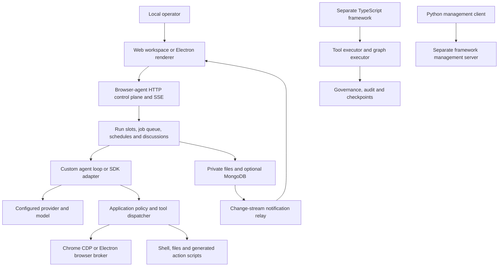

# Architecture review — 27 October 2026

## Decision

**Continue controlled local development; hold a general production release.** The core orchestration choices are sound, but executable script isolation, local API authorization, filesystem confinement, concurrency, dependency hygiene, and desktop restart behavior have concrete gaps. A passing regression suite does not resolve those gaps: nine additional isolated probes reproduced defects that the normal tests do not cover.

This review covers the framework, browser-agent application, desktop shell, provider boundary, tools, persistence, coordination, profiles/learning, synchronization, operational visibility, Python client, and build/test paths. It is a system-wide architecture review with focused code inspection and executable probes at the highest-risk boundaries, rather than a claim that every source line or external integration has been exhaustively audited.

The working tree already contained changes in both repositories, including the earlier model-configuration fix. Those changes were reviewed as part of the current snapshot. This review adds this report and audit evidence; it does not implement the proposed remediation.

Framework base commit: `cee031099e24e09f1b46c54c5e4c289b918cb0f5`. Browser submodule base commit: `06123463f752fd5064b893aa6f1c022c61492bf1`. These identify the bases, not a clean committed release. Tests ran on macOS with Node `v26.5.0`, npm `11.17.0`, and Python `3.13.3`. The browser CI definition targets Node 22, so these local results do not establish that OS/runtime matrix.

## Research basis

I consulted the following primary sources and selected public book chapters. The recommendations below are my application of their principles to this codebase; they are not an endorsement or review by their authors. I did not claim to read inaccessible full books.

| Source | Principle used in the review | Application here |
| --- | --- | --- |
| Malcolm Featonby, Amazon Builders’ Library, [Making retries safe with idempotent APIs](https://aws.amazon.com/builders-library/making-retries-safe-with-idempotent-APIs/) | Give retries a stable identity and distinguish the original operation from a new intent. | Checkpoint resume, queued jobs, schedules and browser effects need execution receipts and reconciliation. |
| Marc Brooker, Amazon Builders’ Library, [Timeouts, retries, and backoff with jitter](https://aws.amazon.com/builders-library/timeouts-retries-and-backoff-with-jitter/) | Bound waits, give retries one owner, and avoid synchronized retry amplification. | Cover whole request lifetimes; use bounded randomized delay and remaining-deadline checks. |
| Alex Perry and Max Luebbe, Google’s *Site Reliability Engineering*, [Testing for Reliability](https://sre.google/sre-book/testing-reliability/) | Establish confidence with tests of concrete failure behavior. | Add adversarial, concurrency, restart and recovery checks alongside ordinary regressions. |
| Alejandro Forero Cuervo, the same book, [Handling Overload](https://sre.google/sre-book/handling-overload/) | Bound work and shed load rather than accumulating unlimited resource demand. | Preserve run slots and queue limits; extend resource limits to connectors, response bodies and telemetry. |
| Rob Ewaschuk, the same book, [Monitoring Distributed Systems](https://sre.google/sre-book/monitoring-distributed-systems/) | Monitor service behavior using useful operational signals. | Track task outcomes, latency, queue delay, failures and resource saturation. |
| Steven Thurgood and David Ferguson, with Alex Hidalgo and Betsy Beyer, *The Site Reliability Workbook*, [Implementing SLOs](https://sre.google/workbook/implementing-slos/) | Define reliability around measurable user journeys. | Set release gates for verified completion, recovery, approval integrity and data preservation. |
| Anthropic, [Building effective agents](https://www.anthropic.com/research/building-effective-agents) | Prefer comprehensible orchestration and add agent complexity when measured results justify it. | Retain deterministic workflows and consolidate duplicated enforcement before adding new executors. |
| Microsoft, [Identify risk for autonomous agentic AI systems](https://learn.microsoft.com/en-us/security/zero-trust/sfi/manage-agentic-risk) | Explicit oversight, least privilege, data protection and trustworthy action reporting. | Authenticate the local control plane and enforce script/tool capabilities outside model text. |
| Node.js, [VM documentation](https://nodejs.org/api/vm.html) | A VM context does not provide an untrusted-code security boundary. | A separate unrestricted Node process with an empty environment still has host filesystem capabilities. |

## Architecture and ownership

The framework and browser application are separate execution stacks. Framework checkpointing and governance do not automatically protect browser-agent runs. The browser’s local pub/sub bus and MongoDB relay distribute facts; neither is a distributed execution lease or an authorization system. The desktop browser broker is narrower and better protected than the general HTTP tool API.

| Area inspected | Assessment |
| --- | --- |
| Framework `agents`, `workflows`, `simple`, governance and checkpoints | Useful composable APIs, but resumability, policy semantics and storage confinement need stronger contracts. The older ReAct executor does not share all native-tool executor governance. |
| Framework provider adapters, callbacks, connectors and tools | Configuration is explicit and provider tests exercise serialization. Timeouts and safe network/file behavior are inconsistent across adapters and tools. |
| Framework MCP and management server; Python client | Suitable building blocks. MCP transport owners must supply authentication and authorization; management authentication is optional. Python requests have no explicit timeout. |
| Browser loop, SDK adapter and tool dispatcher | Good deterministic checks and evidence handling. Policy/context/retry behavior is spread across multiple paths. Generated scripts undermine the intended tool boundary. |
| Queue, run slots, discussion controller and scheduler | Bounded text concurrency and one browser owner are appropriate locally. Jobs interrupted by restart require review instead of automatic replay. Discussions remain process-owned. |
| Profiles, task memory, knowledge, reviewed playbooks and observer | Compact instructions and reviewed lessons are useful. Notifications remain facts; reviewed learning is distinct from model proposals. Preserve those boundaries. |
| User synchronization, local records, workflows and event relay | Some atomic writes, revisions and replay support exist. Their guarantees vary by store; account snapshots still lack conflict-safe updates. |
| Electron, preload, browser broker and Chrome/CDP ownership | Renderer sandboxing, isolated contexts, narrow IPC and broker tokens are positive. The real desktop restart smoke test fails. |
| UI and server composition | Large files concentrate unrelated responsibilities: UI HTML 9,262 lines, server 3,608, loop 2,306, tools 1,411 in this snapshot. Size is a maintenance signal, not itself a correctness defect. |
| Distribution and tests | Both main suites and builds pass locally. Fresh installs succeed with lifecycle scripts disabled. Desktop restart, dependency advisories and a test omitted from the main browser command need attention. |

## Reproduced findings

Severity is scoped to this product: **P0** blocks a release with untrusted/model-generated inputs; **P1** risks data integrity, duplicate effects or a core user journey; **P2** needs correction before relying on the affected feature. P0 does not imply an internet-facing deployment or a demonstrated remote compromise.

### R1 — P0: Generated scripts can bypass tool authorization

Evidence: [scriptWorker.ts:89](/Users/charlesbarathidass/Documents/Development/ai-products/agentfireworks/node/browser_agent/src/scriptWorker.ts:89), [scriptWorker.ts:126](/Users/charlesbarathidass/Documents/Development/ai-products/agentfireworks/node/browser_agent/src/scriptWorker.ts:126), [scriptRunner.ts:107](/Users/charlesbarathidass/Documents/Development/ai-products/agentfireworks/node/browser_agent/src/scriptRunner.ts:107).

The VM exposes functions and constructors from the worker’s host realm. A synthetic script reached the worker’s `process` through an exposed function constructor, obtained filesystem access, and wrote a temporary marker. **Zero tool RPC calls were made.** Disabled dynamic code generation in the VM did not prevent this path. An empty child environment removes inherited secrets but does not remove the child’s operating-system permissions.

Treat this as an actual bypass of the claimed mediated execution boundary, rather than only a theoretical sandbox concern. Prompt-injection resistance cannot compensate for it. The probe did not read real files, credentials or browser data.

Remediation: disable generated scripts until they run behind a real OS/container capability boundary, or replace arbitrary JavaScript with a validated action representation executed by the trusted dispatcher. Fixing one exposed constructor alone does not establish safe isolation. Acceptance: hostile scripts cannot access host processes, files, network or child processes except through explicitly allowed operations, including constructor/prototype and asynchronous escape attempts.

### R2 — P0: The terminal control endpoint accepts a foreign-origin request

Evidence: [server.ts:2804](/Users/charlesbarathidass/Documents/Development/ai-products/agentfireworks/node/browser_agent/src/server.ts:2804), [server.ts:3468](/Users/charlesbarathidass/Documents/Development/ai-products/agentfireworks/node/browser_agent/src/server.ts:3468). Some other routes already call `isSameOriginRequest`; terminal execution does not.

An isolated server accepted `Origin: https://audit.invalid` with `Content-Type: text/plain`, parsed the JSON body, and executed a harmless `printf` command. The response was HTTP 200. This demonstrates missing server-side origin/authentication enforcement. It does not claim successful exploitation through every browser’s private-network restrictions or CORS policy; an attacker does not need to read the response to cause an effect.

Remediation: centralize authorization for all control routes, validate Host/Origin against the configured local endpoint, require JSON for browser mutations, and require an unpredictable per-instance credential/custom header. Give CLI clients an explicit authenticated path. Review run, terminal, approval, browser-input, stop/resume and schedule routes together. Acceptance: foreign-origin, missing-token and invalid-host requests execute no command or model and cannot resolve approvals.

### R3 — P1: Framework editor confinement follows directory symlinks outside the workspace

Evidence: [editor_tool.ts:51](/Users/charlesbarathidass/Documents/Development/ai-products/agentfireworks/src/tools/editor_tool.ts:51).

The path check is lexical. A directory symlink inside a synthetic workspace pointed to another temporary directory; writing through that link succeeded outside the configured root without reporting an error. Reading and patching use the same resolution path.

Remediation: canonicalize existing ancestors and verify real containment, handle new paths and symlinks explicitly, and use operating-system confinement where the directory can change concurrently. Acceptance: symlinks in any path component cannot escape on read/write/append/patch, including nonexistent leaf files. Keep lexical traversal tests as separate coverage.

### R4 — P1: Checkpoint IDs can escape both file-store directories

Evidence: [checkpoints/file.ts:21](/Users/charlesbarathidass/Documents/Development/ai-products/agentfireworks/src/checkpoints/file.ts:21), [workflows/store.ts:72](/Users/charlesbarathidass/Documents/Development/ai-products/agentfireworks/src/workflows/store.ts:72).

Both stores join a caller-supplied checkpoint ID into a filename without validation. Saving `../outside-ID` created a synthetic JSON file outside the configured store. Read/delete derive paths the same way. These are library API boundaries; this review does not claim an existing unauthenticated management route exposes arbitrary checkpoint IDs.

Remediation: strict opaque IDs, canonical containment, schema/version validation, private file modes and atomic replacement. Acceptance: traversal, absolute-path, separator and symlink inputs fail without touching outside files; interrupted writes preserve a readable previous record.

### R5 — P1: Simultaneous checkpoint resumes execute one pending action twice

Evidence: [tool_calling_executor.ts:176](/Users/charlesbarathidass/Documents/Development/ai-products/agentfireworks/src/agents/tool_calling_executor.ts:176), [tool_calling_executor.ts:484](/Users/charlesbarathidass/Documents/Development/ai-products/agentfireworks/src/agents/tool_calling_executor.ts:484).

Two simultaneous resumes of one synthetic checkpoint both completed and executed its single pending action, producing **two effects**. Neither the in-memory/file checkpoint contract nor the executor acquires an execution claim. There is also a crash window between external execution and saving the resulting checkpoint; a checkpoint alone cannot resolve whether an external action happened.

Remediation: claim a run/checkpoint atomically, assign stable action IDs, persist intent/approval/receipt, and reconcile uncertain actions before retry. Use a provider idempotency key when the external API supports one. Website clicks often require observation and explicit operator review instead. Acceptance: concurrent resume has one execution owner; crash injection before/after dispatch never silently repeats an uncertain effect. This follows the distinction in [Amazon’s idempotency guidance](https://aws.amazon.com/builders-library/making-retries-safe-with-idempotent-APIs/).

### R6 — P1: Concurrent local workflow writes collide and can corrupt the shared JSON file

Evidence: [workflowOrchestrator.ts:34](/Users/charlesbarathidass/Documents/Development/ai-products/agentfireworks/node/browser_agent/src/workflowOrchestrator.ts:34), [workflowOrchestrator.ts:69](/Users/charlesbarathidass/Documents/Development/ai-products/agentfireworks/node/browser_agent/src/workflowOrchestrator.ts:69).

The mutation queue is keyed by workflow ID, while all local workflows share one file and a PID-based temporary filename. Creation also goes directly to persistence. Independent operations can read stale arrays and write/rename the same temporary path. In the final 12-create probe, one create fulfilled, 11 rejected, and the resulting file could not be parsed. An earlier run also reproduced write failures with only one retained record. Exact counts vary with scheduling; concurrent-write failure is the stable finding.

Remediation: serialize transactions at the backing-file boundary, use unique temporary files, and protect read/modify/write as one operation. A local transactional database is a reasonable next step if concurrent control-plane writes continue growing. Unique temp names alone do not prevent lost updates. Acceptance: independent concurrent creates and updates all preserve accepted records; multiple store instances/processes either coordinate safely or reject explicitly.

### R7 — P2: Explicit allow rules fail under a deny-by-default policy

Evidence: [policy.ts:26](/Users/charlesbarathidass/Documents/Development/ai-products/agentfireworks/src/governance/policy.ts:26).

A matching `allow` rule was recorded, but the returned decision remained false because the final result always uses `defaultAllow`. This is a false denial, not a demonstrated unauthorized grant. It makes a useful restrictive configuration unusable and can pressure callers to loosen defaults.

Remediation: define and test deny-overrides semantics: any matching deny rejects, otherwise a matching allow permits, otherwise use the default. Acceptance includes mixed rule order, asynchronous rules, no match and both defaults.

### R8 — P2: Non-finite budget inputs disable numerical enforcement

Evidence: [budget.ts:47](/Users/charlesbarathidass/Documents/Development/ai-products/agentfireworks/src/governance/budget.ts:47), [budget.ts:148](/Users/charlesbarathidass/Documents/Development/ai-products/agentfireworks/src/governance/budget.ts:148).

After a budget of one was exhausted, consuming `NaN` succeeded and a subsequent consumption of 100 also succeeded. Non-finite arithmetic defeats the comparison. This was a direct library-API probe; JSON itself cannot encode NaN, and no remotely reachable NaN injection was demonstrated. Negative amounts/limits also need explicit validation.

Remediation: validate finite non-negative amounts and limits in global/scoped managers; reject invalid configuration rather than poisoning usage. Reserve/commit usage consistently when multiple scopes are checked. Acceptance: invalid input leaves usage unchanged and cannot restore capacity.

### R9 — P2: BrowserTool’s deadline ends before response-body consumption

Evidence: [browser_tool.ts:89](/Users/charlesbarathidass/Documents/Development/ai-products/agentfireworks/src/tools/browser_tool.ts:89).

The timeout is cleared after response headers arrive, before reading the body. An abort-aware synthetic response with a 10 ms deadline completed successfully after about 89 ms. A slow/stalled body can therefore hold resources beyond the configured timeout. The content length is bounded only after the entire body has been buffered.

Remediation: keep the deadline through body consumption and cleanup in `finally`; enforce an incremental byte limit and bound redirects. Review generic connector fetches and the Python client, which currently have no explicit deadlines. Acceptance: slow headers, slow body, stalled body and oversized responses all stop within bounded resources.

## Additional release and architecture risks

### R10 — P1: Real desktop backend-restart smoke test fails reproducibly

`npm run test:desktop` failed twice at [testDesktop.js:170](/Users/charlesbarathidass/Documents/Development/ai-products/agentfireworks/node/browser_agent/scripts/testDesktop.js:170), with `page.reload: net::ERR_CONNECTION_REFUSED` after the backend-restart section. The second execution ran without the two full regression suites. Layout, editor input, tab switching and popup checks had passed before that point. Chat ownership checks later in the script were not reached.

The test’s readiness predicate uses `hasBrowserSession === false`, which is a state observation rather than a stable process-generation/health handshake. That is a plausible race contributor, not a proven complete diagnosis. Do not report restart preservation as validated until the failure is understood and both product readiness and test synchronization are corrected. The browser CI file currently runs `npm test` and a production build, rather than this full Electron smoke test.

### R11 — P1: The framework production lockfile has high-severity advisory entries and differs from the installed tree

`npm audit --omit=dev --json` returned **three high-severity package entries**: `image-size`, `nanoid`, and the affected dependent `pptxgenjs`. The leaves include [image-size parser loop advisories](https://github.com/advisories/GHSA-5p2g-fcmc-qvqq), [the ICNS advisory](https://github.com/advisories/GHSA-w3rx-r6r6-pgpr), [a nanoid negative-size advisory](https://github.com/advisories/GHSA-28wg-ghj8-5hjv), and [a nanoid overflow advisory](https://github.com/advisories/GHSA-xwg4-73v4-xw9w). This is not three separately proven application exploits; reachability through actual document generation was not demonstrated.

The framework lock selects `docx 9.6.1` / `nanoid 5.1.9`; the working installation has `docx 9.13.0` / `nanoid 6.0.2`. Both use `pptxgenjs 4.0.1` / `image-size 1.2.1`. The 41 framework tests also passed in a fresh temporary install using the lock, so compatibility tests alone do not detect these advisory risks. The browser production dependency audit reported zero known entries at review time. Neither audit proves absence of unknown vulnerabilities, and the browser check excluded development dependencies such as the Electron shell.

Remediation: reconcile manifests/lockfiles and resolve vulnerable transitive versions with a reviewed compatibility change. Re-test document generation using the resulting locked tree. Avoid blindly forcing the audit’s suggested dependency downgrade. Both projects’ fresh installs succeeded with lifecycle scripts disabled; an old audit’s peer-conflict warning was not reproduced by this check.

### R12 — P1 for sync/hosted use: Identity, snapshot writes and execution ownership remain limited

[userStore.ts:352](/Users/charlesbarathidass/Documents/Development/ai-products/agentfireworks/node/browser_agent/src/userStore.ts:352) reads a user snapshot and writes it back without a revision predicate. Two devices can overwrite each other’s transcript/settings changes despite deletion tombstones. This is a source-confirmed race risk; a live multi-device MongoDB experiment was not run. Add compare-and-swap revisions or granular idempotent operations and a durable offline outbox.

The application’s execution state is keyed largely by bot names and process-owned maps. Google sign-in on account-data routes does not isolate tools, browser sessions, files or approvals by authenticated account. MongoDB change streams provide notifications, not tenant isolation or execution fencing. Preserve the supported single-operator boundary; shared hosting requires a distinct identity and capability design, plus durable claims.

Discussion state itself remains in [server.ts:811](/Users/charlesbarathidass/Documents/Development/ai-products/agentfireworks/node/browser_agent/src/server.ts:811). Durable coordination receipts provide useful historical evidence but do not reconstruct an interrupted live discussion. Persist the discussion goal, stable bot IDs, admission decisions, outcome references and terminal state if restart continuity is a supported promise.

### R13 — P2: Timeout/retry and SSH trust behavior need consistent contracts

The browser loop correctly disables SDK retries and classifies transient failures, but [promptLoop.ts:1835](/Users/charlesbarathidass/Documents/Development/ai-products/agentfireworks/node/browser_agent/src/promptLoop.ts:1835) uses deterministic linear delay without jitter. Limit retries by the remaining overall deadline, honor suitable provider retry hints, and randomize bounded delays. Keep model retries distinct from retries of outward effects. These recommendations follow [Amazon’s retry article](https://aws.amazon.com/builders-library/timeouts-retries-and-backoff-with-jitter/).

The framework SSH tool explicitly uses `StrictHostKeyChecking=no` in [ssh_tool.ts](/Users/charlesbarathidass/Documents/Development/ai-products/agentfireworks/src/tools/ssh_tool.ts). Default to verified host identity with an explicit provisioning/known-hosts procedure. Its general remote execution capability also needs a caller-owned host/command policy; an agent prompt is not that policy. No real SSH session was opened during this review.

### R14 — P2: Enforcement and observability are fragmented

The older framework executor, native-tool executor, workflow executor, browser custom loop, SDK path and script path have different enforcement surfaces. This makes capability and recovery guarantees difficult to state. The earlier silent Local Engine fallback was one example of this divergence; its current correction and preflight regression checks are present and pass.

Retain the local application as a modular monolith, extracting typed model, run, policy/dispatch and storage services. Bind each request to immutable run ID, bot ID, workspace, capability set and deadline. Make every executor use the same dispatch contract. Compare SDK/custom-loop behavior against the same policy and outcome fixtures before choosing one default.

Existing usage counters, outcomes and event streams are useful but do not establish a task-quality or availability SLO. Track verified completion and duplicate-effect incidence, time to first useful result, end-to-end p50/p95, queue age, model/tool retries, unknown outcomes, approval violations, and tokens/cost per successful task. Mark unknown pricing explicitly. Set targets after measuring a representative baseline rather than inventing release claims. [Google’s SLO chapter](https://sre.google/workbook/implementing-slos/) provides the operating model.

## Validation results

| Check | Result | Evidence |
| --- | --- | --- |
| Framework `npm test` | **41/41 passed**, source scan zero findings | [framework log](/Users/charlesbarathidass/Documents/Development/ai-products/agentfireworks/output/architecture-review-2026-10-27/framework-tests.log) |
| Browser `npm --prefix node/browser_agent test` | **357/357 passed**, source scan zero findings | [browser log](/Users/charlesbarathidass/Documents/Development/ai-products/agentfireworks/output/architecture-review-2026-10-27/browser-tests.log) |
| Additional site-adapter tests | **5/5 passed**; the existing test file is omitted from the main browser test list | [adapter log](/Users/charlesbarathidass/Documents/Development/ai-products/agentfireworks/output/architecture-review-2026-10-27/site-adapter-tests.log) |
| Python management-client tests | **2/2 passed** | [Python log](/Users/charlesbarathidass/Documents/Development/ai-products/agentfireworks/output/architecture-review-2026-10-27/python-tests.log) |
| Framework against freshly installed locked dependencies | **41/41 passed again**, isolated build | [locked-tree log](/Users/charlesbarathidass/Documents/Development/ai-products/agentfireworks/output/architecture-review-2026-10-27/framework-locked-tests.log) |
| Fresh dependency install, both projects | Passed with lifecycle scripts disabled; working installations preserved | [framework install](/Users/charlesbarathidass/Documents/Development/ai-products/agentfireworks/output/architecture-review-2026-10-27/framework-clean-install.log), [browser install](/Users/charlesbarathidass/Documents/Development/ai-products/agentfireworks/output/architecture-review-2026-10-27/browser-clean-install.log) |
| Browser production TypeScript build | Passed | [build log](/Users/charlesbarathidass/Documents/Development/ai-products/agentfireworks/output/architecture-review-2026-10-27/browser-production-build.log) |
| Electron desktop smoke | **Failed twice** during backend restart | [first execution](/Users/charlesbarathidass/Documents/Development/ai-products/agentfireworks/output/architecture-review-2026-10-27/desktop-tests.log), [repeat](/Users/charlesbarathidass/Documents/Development/ai-products/agentfireworks/output/architecture-review-2026-10-27/desktop-retry.log) |
| Isolated architecture probes | **9/9 reproduced defects**, not security passes | [observations](/Users/charlesbarathidass/Documents/Development/ai-products/agentfireworks/output/architecture-review-2026-10-27/audit-probes.json), [reproduction harness](/Users/charlesbarathidass/Documents/Development/ai-products/agentfireworks/output/architecture-review-2026-10-27/audit-probes.cjs) |
| Production dependency audit | Framework: **3 high package entries**; browser: **0 known entries** | [framework JSON](/Users/charlesbarathidass/Documents/Development/ai-products/agentfireworks/output/architecture-review-2026-10-27/framework-dependency-audit.json), [browser JSON](/Users/charlesbarathidass/Documents/Development/ai-products/agentfireworks/output/architecture-review-2026-10-27/browser-dependency-audit.json) |
| Both repository diffs | Whitespace/error check passed | `git diff --check` in parent and submodule |

There were **405 passing distinct ordinary tests** across framework/browser/adapter/Python suites, plus the repeated 41-test framework run against locked dependencies. The desktop failure and adversarial findings prevent an overall passing release verdict.

The probe harness uses synthetic checkpoints, mocked provider-independent behavior, temporary directories and an isolated local server. It never prints secrets or reads personal browser/account data. A zero exit code from that harness means its observations completed; `findingReproduced: true` means the expected safety/correctness property was violated.

Not validated here: live paid-model quality, real Google OAuth configuration, actual account analytics or publishing, live MongoDB outages/two-device conflict recovery, production soak/load behavior, signed installers and the supported OS/Node matrix. The existing fixture suites cover some related component behavior, but cannot substitute for those end-to-end checks.

## Remediation sequence and acceptance gates

1. **Contain execution and authenticate the local control plane.** Resolve R1/R2 before distributing a build that executes model-generated scripts or accepts local web control. Require adversarial tests to demonstrate zero unauthorized effects.
2. **Make persistence and recovery explicit.** Resolve R3–R6; standardize opaque IDs, private atomic writes, schema versions, transactional mutation and run/action claims. Add crash injection and concurrent writers. Require accepted work to survive without corruption or duplicate execution.
3. **Restore a reproducible release baseline.** Resolve the desktop restart failure, align and audit locked dependencies, include the omitted test, and run Electron smoke tests in an appropriate CI desktop environment. Require clean install, compile, tests and release-gate checks from the same dependency snapshot.
4. **Consolidate contracts while preserving useful modules.** Correct policy/budget/deadline behavior, share model/dispatch interfaces, use stable IDs, and add typed storage repositories. Make the intended single-operator guarantees easy to test and document.
5. **Measure operational readiness.** Establish user-journey SLOs and a fixed task-evaluation set; then validate live providers, OAuth, backup/restore, MongoDB recovery and deployment/rollback. Add shared-hosting support only after account-scoped execution and durable ownership are demonstrated.

The immediate engineering priority is enforcing these boundaries and proving failure behavior. New autonomy or additional agent frameworks would expand the verification burden before the current release blockers are resolved.
