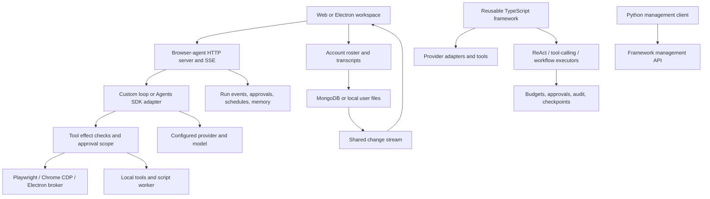

# Architecture review and implemented improvements

Reviewed 2026-10-24. Scope: the TypeScript framework, browser-agent submodule, Electron boundary, persistence/synchronization, tool execution, provider adapters, Python companions, configuration, and observability. This is a source review and deterministic regression exercise, not a security certification or a production performance benchmark.

## Assessment

The strongest design is already present: a model proposes a structured action, deterministic code checks its effect and authorization, a tool executes it, and the next decision uses observed results. Keep that loop small and inspectable. Extra model calls, universal playbooks, alternative executors, and delegation should earn their complexity through measured task success.

“Karpathy-inspired” here is my engineering interpretation of his [nanochat repository](https://github.com/karpathy/nanochat): favor a comprehensible end-to-end implementation and reproducible evaluation. This is not a review or endorsement by Andrej Karpathy. The runtime is an application harness, not a model-training system.

## Current system and ownership

The reusable framework and browser application are separate runtimes. The browser application does not execute through the framework's checkpointed executor; adding a feature to one does not automatically give it to the other. Python primarily supplies clients/artifact utilities rather than a third complete agent runtime. Electron's native browser broker has a narrower boundary than the application's general-purpose local shell.

## Findings and disposition

| Priority | Finding and evidence | Result of this change |
| --- | --- | --- |
| High | Provider versions were duplicated in `src/chat_models`, `src/llms`, `src/embeddings`, browser `promptLoop.ts`, image generation, patch proposals, and both model menus. Import-time defaults preceded server `.env` loading. | Provider versions are configuration; the server and CLI load `.env` first. Framework constructors require explicit configuration or provider environment variables. UI menus consume the server catalog. |
| High | Browser orchestration and patch proposals could use an OpenAI key for another provider. | Removed cross-provider credential fallback; registry metadata selects the provider and API mode. Existing no-key Local Engine behavior remains. |
| High | `security.ts` redacted only a few token formats. Structured tool arguments, opaque env credentials, terminal command text, URLs, framework trace input/output, and audit details could expose secrets. | Expanded string/structured redaction at model input, event, log, trace, audit, and terminal-history boundaries. Shell children no longer inherit MongoDB/database URL credentials. Settings credential fields clear after save. Source scanners added to both repositories and their test commands; package publication also runs the parent scan. |
| High | `loopGuard.ts` pruned screenshots but text-only histories continued to grow. The Responses chain could retain removed history remotely. | The custom loop now caps text context by removing complete old rounds, keeping system instructions, the original task and recent observations. Compaction resets Responses chaining. Oversized retained context fails explicitly. |
| High | SDK orchestration did not apply the custom loop's circuit-breaker check before every tool dispatch. | The SDK adapter checks the shared step/time limits before execution and reduces remaining SDK turns across retries. |
| Medium | SDK automatic retries and loop retries could multiply requests; all API errors were retried. | One retry owner, configurable request timeout, and retries limited to transient failures. Deterministic invalid-request/auth failures return immediately. |
| Medium | Browser and framework pricing tables embedded version-specific prices. | `MODEL_PRICING_JSON` owns optional estimates; unknown model pricing is not guessed. |
| High, open | Browser `server.ts` has global `currentRun`, browser session and discussion state. Google sign-in protects user-data endpoints but does not turn the tool server into an account-isolated execution service. | Preserve the local, single-operator deployment boundary. Before shared hosting, scope execution, tools, files, memory and approvals by authenticated account/workspace. |
| High, open | Mongo user saves read a document and replace roster/settings. Change streams improve observation but cannot make concurrent cross-device writes conflict-safe. Local fallback is not a durable offline operation log. | Existing stream, save serialization, retries and deletion tombstones remain. Next persistence change should introduce revision checks or idempotent per-bot/per-message operations and an offline outbox. Test two writers and reconnection before rollout. |
| High, open | Browser runs, approvals and message-bus coordination are memory-owned. The framework's file checkpoints do not protect browser execution on a server restart. | Persist execution state separately from UI/account snapshots. Record planned action, authorization, execution receipt and observation; uncertain outward effects require reconciliation before retry. |
| High, open | Arbitrary shell commands and Playwright execution operate with host capabilities. Environment filtering and a script VM are not a complete sandbox against filesystem reads or network exfiltration. | Retain explicit authorization and local-only use. A worker/container with scoped filesystem, credentials and network capabilities is required before running untrusted work or hosting multiple users. |
| Medium, open | Two browser engines and several framework executors enforce overlapping behavior. SDK internal conversation state does not use the new custom-loop compactor. | Keep the engine switch for compatibility; measure parity and converge policy/tool dispatch behind one interface. Test SDK session compaction separately before enabling it. |
| Medium, implemented | The universal system prompt included multiple unrelated niche playbooks on every request. | Shared AGENTS.md and soul.md now combine with deterministically selected, bounded role playbooks and reviewed lessons. Coordinator outcomes use short references and paginated reads. See node/browser_agent/docs/agent-profiles.md for configuration, measurements and limits. |
| Medium, open | File-backed checkpoints and workflow records are plain JSON without a transaction log; durable resumability and exactly-once outward effects are different properties. | Use atomic private writes, validated record IDs, schema/version migration and durable receipts as a follow-on persistence change. |
| Medium, open | Regex action classification and model-declared effects can miss novel UI semantics. | Keep independent observed-effect checks and evidence verification; expand adversarial authorization evals rather than treating prompts as a permission boundary. |

## Reported sign-in and persistence issues (2026-10-24)

- **High, open — Google sign-in blocked (`redirect_uri_mismatch`).** User screenshot shows Google Error 400 after starting the built desktop app. The supplied log reports the built UI origin as `http://127.0.0.1:8766`; development uses port 8765. The server constructs `loginUri` from the request origin with `/api/auth/google/callback`, so the expected built callback is `http://127.0.0.1:8766/api/auth/google/callback`. Verify the actual failing request's redirect URI and the active OAuth client's Authorized redirect URIs; adding JavaScript origins alone does not register the callback. Google Cloud configuration has not been inspected, so the precise missing/mismatched entry remains unconfirmed. See [Google's redirect URI requirements](https://developers.google.com/identity/protocols/oauth2/web-server#authorization-errors-redirect-uri-mismatch) and `node/browser_agent/README.md` Google OAuth setup. Acceptance: complete system-browser sign-in and the one-time Electron handoff on both configured dev and built ports.
- **High, open — MongoDB connection timeout during account lookup.** The supplied built-server log shows `MongoServerSelectionError`, TLS `secureConnect` timing out after 8004 ms, and `ReplicaSetNoPrimary` during `getUserByGoogleSub`. This is a separate failure from Google's redirect rejection; its underlying connectivity cause is unconfirmed. Check database reachability, TLS/network access and configured connection settings without printing credentials. Handle persistence outages with a clear recoverable sign-in/sync error and preserve unsynced local work; do not silently switch account stores. Acceptance: simulate an unavailable database, verify bounded failure and a usable retry path, then verify successful sign-in/sync after recovery.

The development log also shows watcher-triggered restarts and policy-rejected handoffs. These messages do not establish the cause of either sign-in failure above.

## Research translated into this implementation

This is a selected set of primary sources. Claude is Anthropic's model family, and ChatGPT is an OpenAI product; neither is a separate research organization. Model training methods cannot be applied merely by adding a prompt or another agent.

| Primary source | Applicable idea | Concrete application and limits |
| --- | --- | --- |
| [Anthropic: Building effective agents](https://www.anthropic.com/research/building-effective-agents) | Prefer simple, composable workflows; add autonomous orchestration when needed. | Preserve deterministic tool checks and keep configuration/policy outside model prose. No blanket planner/critic swarm was introduced. |
| [Anthropic: Effective context engineering](https://www.anthropic.com/research/effective-context-engineering-for-ai-agents) | Treat context as a limited resource; keep relevant evidence and compact long trajectories. | Bounded text history, complete tool-round removal, retained task/recent observations, explicit compaction events, configurable limits. This is deterministic eviction, not semantic summarization. Older evidence must remain in durable memory/retrievable sources if needed later. |
| [OpenAI: Evaluation best practices](https://developers.openai.com/api/docs/guides/evaluation-best-practices) | Evaluate component behavior and full workflows with explicit criteria. | Deterministic tests cover provider isolation, env precedence, context/tool-pair integrity, secret-safe telemetry, save races and existing browser approval behavior. Paid model quality/latency evaluations are still required before claiming task-success improvements. |
| [Meta: Toolformer](https://ai.meta.com/research/publications/toolformer-language-models-can-teach-themselves-to-use-tools/) | Let models select tools and incorporate their results rather than replace tools with simulated answers. | Retain native tool contracts and structured execution feedback. Toolformer is a training procedure; this patch does not train models or claim its published gains. |
| [Meta: Agents Research Environments](https://github.com/facebookresearch/meta-agents-research-environments) | Evaluate realistic, changing environments and actual resulting state. | Existing local browser fixtures and evidence checks are the baseline. A production-like changing-environment benchmark suite is a follow-on, not an installed dependency or claimed result. |

## Configuration and compatibility

- Framework: explicit constructor `model` wins over `OPENAI_MODEL`, `ANTHROPIC_MODEL`, `GEMINI_MODEL`, `PERPLEXITY_MODEL`, `OLLAMA_MODEL`, and `OPENAI_EMBEDDING_MODEL`. The library does not read files implicitly. Load `.env` through the host application. Missing model configuration now raises an actionable error, replacing silent version defaults.
- Browser app: `.env` loads before defaults; inherited environment wins. `BROWSER_AGENT_MODEL` selects the default. Provider model vars populate the menus; `BROWSER_AGENT_MODELS_JSON` adds explicit `{id,label,provider,api}` entries. Registry metadata overrides legacy model-prefix inference.
- `OPENAI_API_MODE` chooses `responses` or `chat` for unregistered OpenAI models. Reasoning effort is configurable. Responses chaining remains enabled between compactions; no promise of zero provider-side retention is made.
- `OPENAI_IMAGE_MODEL` controls image generation. `BROWSER_AGENT_PATCH_MODEL` can choose a separate patch model; an explicitly supplied run model takes precedence.
- Step, wall-time, output, text-context and tool-result budgets are documented in the browser `.env.example`. Text-character budgets are deterministic approximations, not tokenizer-exact model context limits. Images and SDK internal histories have separate behavior.
- Existing local model selections were preserved rather than upgraded. Example versions reflect previous defaults and can be replaced without editing runtime code. Provider availability and prices must be verified by the operator.
- Local credential files are ignored and owner-readable only. The secret scanner inspects working source, including initialized submodules and configured local secret values, without printing credential contents.

## Validation and measurement

Validation passed: 41 framework tests and 225 browser-agent tests. Both test commands also passed their source secret scans. Inline browser scripts parse successfully and both Git diffs pass whitespace/error checks.

The framework and browser regression suites are run separately. Browser tests compile to `.test-dist`, isolated from a live development watcher writing `dist`; this prevents tests from importing partially rewritten modules. Browser tests include deterministic mocked providers and local browser fixtures; the added context/config tests do not make paid model calls. Source scans and syntax/build checks supplement tests.

A synthetic text-only trajectory verifies that compaction stays under its character budget while retaining recent tool-call/result pairs. This demonstrates bounded prompt size, not a measured production latency, cost, or success-rate gain. Before a model or orchestration change, measure completion rate, verified final state, p50/p95 latency, input/output tokens, retries, approval violations, and recovery behavior on the same task set. Introduce expensive planning/delegation only when those measurements justify it.

Current-source scanning found no credentials. A high-confidence pattern scan of locally available Git history found one alphabet-sequence key fixture in a redaction test, not an identified live credential. These checks do not prove that arbitrary encoded secrets, remote branches, or every past artifact are clean.

## Implemented profile and async follow-up

The browser runtime now has compact Markdown profiles, reviewed playbook revisions, scoped MongoDB state notifications, compact task-outcome references, and a backend asynchronous queue. Shared browser execution remains serialized; the pending queue is still process-owned. This addresses prompt duplication and UI-owned queue lifetime, not the open distributed execution or tenant-isolation findings above. The latest validation is recorded in the runtime profile documentation.
